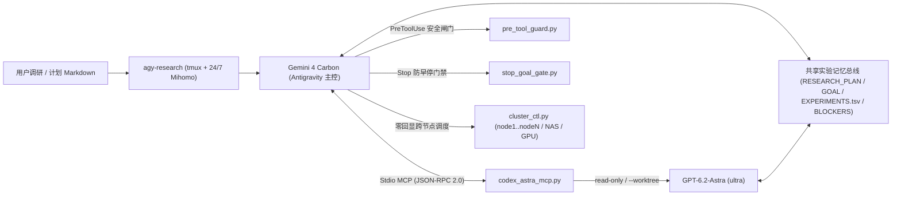

# Antigravity × Codex Auto Research Hub

一套面向多节点 Linux GPU 集群与单机科研环境的 **双 CLI 异构智能体长程自治科研框架（Auto Research）**：由 **Google Antigravity CLI (`agy` / Gemini 4 Carbon)** 担任长视野主控编排与科学实验管理，通过零依赖本地 **Stdio MCP** 无缝调度 **OpenAI Codex CLI (`codex` / GPT-6.2-Astra `ultra`)** 担任核心算法实现、独立审稿与疑难卡点破局专家。

---

## 核心架构设计



### 核心特性
1. **异构双旗舰单写者协同（Carbon × Astra `ultra`）**
   - `codex_astra_mcp.py` 以纯 Python 3.10+ 标准库实现（零第三方 pip 依赖），运行在宿主机 `ls_core` 下，向 Carbon 暴露 4 个原生工具：
     - `astra_consult`：严格 `read-only` 沙盒下的实验方案审阅、数学推导验算与 NaN/不收敛根因诊断，返回 `thread_id`；
     - `astra_code`：默认启用 `--worktree` 在独立 Git worktree 中编写复杂核心模块与单元测试（自动开启受控网络，避免与主工作树发生双写冲突）；
     - `astra_resume`：基于 `thread_id` 进行多轮连续技术辩论与迭代调优；
     - `astra_review`：启动耗时多卡或跨节点训练前的独立第三方 Code Review（专查数据泄漏、评估口径错误、广播/DDP 隐患与路径越界）。
2. **两道确定性生命周期护栏（`hooks.json`）**
   - `PreToolUse`（`pre_tool_guard.py`）：硬拦截删除根目录/冻结只读原料盘、拦截终端回显凭据/代理订阅配置、拦截 `codex` 以 `danger-full-access` 裸奔、保护后台自动占卡守护进程红线；常规科研命令显式返回 `allow` 实现无人值守零卡顿。
   - `Stop`（`stop_goal_gate.py`）：读取课题 `RESEARCH_GOAL.json` 中的最小实验轮数（`min_experiments`）与必交产物清单，未达标时自动将 Agent 拉回科学实验闭环（遵守 `continuationActive` 防死循环锁）。
3. **跨节点零回显 GPU 与存储控制器（`scripts/cluster_ctl.py`）**
   - 单机开箱即用（自动探测本机 GPU 与磁盘），配置 `config/cluster.local.json` 后支持多节点并发巡检（`status`）、智能选卡（`recommend-gpus`）、识别备用占卡服务（`RESERVED_BY_US` vs `EXCLUDED_IN_USE`）、后台脱离终端拉起训练（`launch-bg`，自动注入 `CUDA_DEVICE_ORDER=PCI_BUS_ID`）、状态与日志巡检（`check-job`）以及 `rsync` 传数（`sync`）。
4. **24/7 脱离客户端休眠的常驻守护（`tmux` + `proxy/setup_local_mihomo.py`）**
   - 一键部署用户级 `systemd` 常驻 `mihomo`（Clash Meta）代理服务（默认 `127.0.0.1:27890`，0ms 无 GeoIP 依赖启动，自动优选美/新/台 IEPL 节点并注入内网 `NO_PROXY`），彻底摆脱笔记本 SSH `-R` 反向代理休眠断流问题。

---

## 目录结构

```text
auto_research/
├── install.sh                               # 跨节点一键初始化、模板渲染、插件安装与全链路自检脚本
├── bin/
│   └── agy-research                         # 启动入口（默认 --mode auto、免沙盒跨节点调度、智能探测本机 27890 代理、支持 -t tmux）
├── config/
│   ├── cluster.example.json                 # 集群节点、共享存储与自动占卡配置模板（复制为 cluster.local.json 生效）
│   └── cluster.local.json                   # [Git 忽略] 本机/本集群私有拓扑配置
├── mcp/
│   └── codex_astra_mcp.py                   # 零依赖 Stdio MCP Server（默认 gpt-6.2-astra + ultra）
├── hooks/
│   ├── pre_tool_guard.py                    # PreToolUse 确定性安全闸门
│   └── stop_goal_gate.py                    # Stop 目标完成度门禁（支持课题内与父目录会话自动发现）
├── proxy/
│   └── setup_local_mihomo.py                # 本机 24/7 常驻 Mihomo (Clash Meta) 一键部署与连通性体检工具
├── plugins/
│   └── auto-research/                       # 原生 Antigravity 插件包（含 MCP 模板、Hooks 模板、常驻规则与 2 个协同 Skills）
├── scripts/
│   ├── ar_config.py                         # 可重定位路径与集群配置加载器
│   ├── cluster_ctl.py                       # 多节点/单节点 GPU 巡检、后台任务投递与 rsync 同步工具
│   ├── init_experiment.sh                   # 一键初始化带 Git 首提交 + 数据盘软链 + 共享记忆总线的课题仓库
│   ├── log_experiment.py                    # 规范化写入/查看 EXPERIMENTS.tsv 实验台账
│   ├── sync_plugin.sh                       # 渲染本机绝对路径并校验、安装、启用 auto-research 插件
│   └── self_check.py                        # 32 项端到端回归自检套件
├── templates/                               # 共享实验记忆总线模板（RESEARCH_PLAN.md / RESEARCH_GOAL.json / EXPERIMENTS.tsv / BLOCKERS.md）
├── workflows/
│   └── dual_hypothesis_tournament.py        # Antigravity run_workflow 脚本：并行设计多条实验假设 + Astra Ultra 交叉评审
├── codex_profiles/                          # Codex 安全分层配置（astra-ro.toml / astra-code.toml）
├── logs/                                    # [Git 忽略] Astra 调用审计记录与 Hook 日志
└── projects/                                # [Git 忽略] 具体科研子课题实验仓库目录
```

---

## 在任意新节点快速部署复用（3 步到位）

### 前置条件
目标 Linux 节点已安装 Python 3.10+、`git`、`tmux`，以及：
- **Antigravity CLI (`agy`)**：`curl -fsSL https://antigravity.google/cli/install.sh | bash`（首次运行 `agy` 完成登录，建议在 `/model` 中切换为 `Gemini 4 Carbon`）
- **OpenAI Codex CLI (`codex`)**：安装后执行 `codex login` 完成认证

### 第 1 步：拉取仓库并执行一键安装
无论目标节点主目录在 `/home/<user>` 还是 `/mnt/workspace/<user>`，克隆到任意位置后直接运行 `./install.sh`：

```bash
git clone https://github.com/realogisosetsuna/antigravity-codex-autoresearch.git ~/auto_research
cd ~/auto_research
./install.sh
```
`./install.sh` 会自动完成：
- 按当前节点的真实路径渲染插件的 `mcp_config.json` 与 `hooks.json`；
- 将 `agy-research` 软链至 `~/.local/bin/agy-research`（确保 `~/.local/bin` 在 `PATH` 中），将安全配置软链至 `~/.codex/astra-{ro,code}.config.toml`；
- 执行 `agy plugin validate --strict`、`agy plugin install`、`agy plugin enable auto-research`；
- 运行 `scripts/self_check.py` 跑通全部 32 项本地协议与安全断言。

### 第 2 步（可选）：配置本机 24/7 独立代理（脱离笔记本 SSH 反向隧道）
若节点访问 Google / OpenAI 需要代理且已放置 `~/.local/bin/mihomo`：
```bash
# 隐藏输入订阅地址（不留命令历史，配置自动设为 0600 权限并注册 systemd 常驻服务）
python3 ~/auto_research/proxy/setup_local_mihomo.py setup --prompt-url
python3 ~/auto_research/proxy/setup_local_mihomo.py status
```

### 第 3 步（可选）：配置多节点集群拓扑
若仅在当前单机跑实验无需配置（`cluster_ctl.py` 会自动探测本机 GPU 与磁盘）；若需跨节点调度 GPU：
```bash
cp ~/auto_research/config/cluster.example.json ~/auto_research/config/cluster.local.json
# 按实际节点 IP、本地数据盘与只读保护目录修改 cluster.local.json（该文件已被 Git 忽略，不会误提交）
python3 ~/auto_research/scripts/cluster_ctl.py status
```

---

## 日常使用指南

### 场景 A：直接把已有的调研 / 研究计划 Markdown 交给新会话自动建库开跑
1. 启动挂在 `tmux` 里的持久会话：
   ```bash
   agy-research -t ar_my_topic
   ```
2. 在会话中输入（先 `/plan` 对齐再 `/goal`，或直接 `/goal` 全自主推进）：
   ```text
   /plan 请阅读我的调研与计划文档 ~/notes/survey.md 和 ~/notes/plan.md，
   在 auto_research/projects/ 下初始化新课题（大文件目录软链到空间充足的 /mnt/data1/$USER），
   将原文档归档至 docs/ 并提炼出 RESEARCH_PLAN.md，巡检可用 GPU，
   调用 astra_consult (ultra) 联合审查实验方案与潜在数据泄漏风险后给出执行计划。
   ```
3. 确认方案后启动长程闭环：
   ```text
   /goal 将 RESEARCH_GOAL.json 设为 active=true, min_experiments=5 并绑定当前会话 ID，
   配合 Astra Ultra（核心模块用 astra_code 在 worktree 实现，长训练前用 astra_review 审计）自主推进实验直至达标。
   ```

### 场景 B：运行途中无侵入巡检与断连恢复
- **随时重连实时 TUI**：`agy-research -t ar_my_topic`（退出回后台按 `Ctrl+B` 松开再按 `D`）
- **外部终端查看实验台账**：
  ```bash
  python3 ~/auto_research/scripts/log_experiment.py --project-dir ~/auto_research/projects/<topic> --show
  ls -lt ~/auto_research/logs/astra_calls/ | head -n 10
  tail -n 20 ~/auto_research/logs/hooks.log
  ```
- **意外中断接续**：`agy-research -P <topic> -t ar_my_topic -- -c` 恢复最近对话，或直接在新会话中指示读取 `projects/<topic>` 下的 `RESEARCH_PLAN.md`、`EXPERIMENTS.tsv` 与存活训练 PID 无损续跑。
